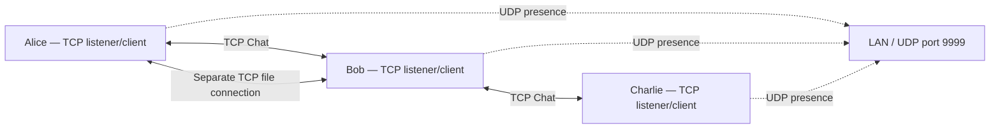

# Architecture — Leader design

## Topology
Every peer listens on a TCP port and may connect directly to other peers; **there is no central chat server**. UDP discovery (Member 2) broadcasts presence to UDP port 9999 every three seconds and expires peers after ten seconds. TCP chat and file transfers use reliable streams. File transfers use **a separate TCP socket** so they do not block messages.



## TCP framing
```text
[4-byte uint32 big-endian header length][UTF-8 JSON header][payload if size specified]
```
- `send_frame` and `receive_frame` transfer **header only**.
- `receive_exact` loops on `recv()` because TCP is a **byte stream**, not a message queue.
- Initiator sends `HELLO`; responder replies `HELLO_ACK`, exchanging protocol version, peer ID, name, TCP listening port. **This is application-layer handshake, not TCP SYN/SYN-ACK/ACK.**
- `MESSAGE` frame declares payload `size` in UTF-8 bytes; `BYE` closes a chat session.
- `FILE_OFFER` is the first frame on a separate TCP connection; Member 3 owns the receiving callback.

## Thread model
- Main thread: command input / interface.
- TCP accept thread: accepts new socket connections.
- Per-chat receiver thread: framing, history, unread count and notifications.
- Member 2 adds UDP broadcaster, UDP listener, timeout cleanup and typing-safe UI.
- Member 3 adds independent sender worker per transfer.

## Synchronization
- `ChatNode._lock` protects shared peer list/history/unread/active selection.
- `conn.write_lock` keeps outgoing header and payload operations together.
- `ChatNode.events` is a thread-safe queue; the UI never reads chat sockets itself.
- `peer_id` identifies one process/session across UDP discovery and TCP HELLO.

## Limitations
TCP-only developer console is not typing-safe. Chat history is RAM-only. No login, encryption or per-message delivery acknowledgments. UDP/real file transfer/final demo are pending.
